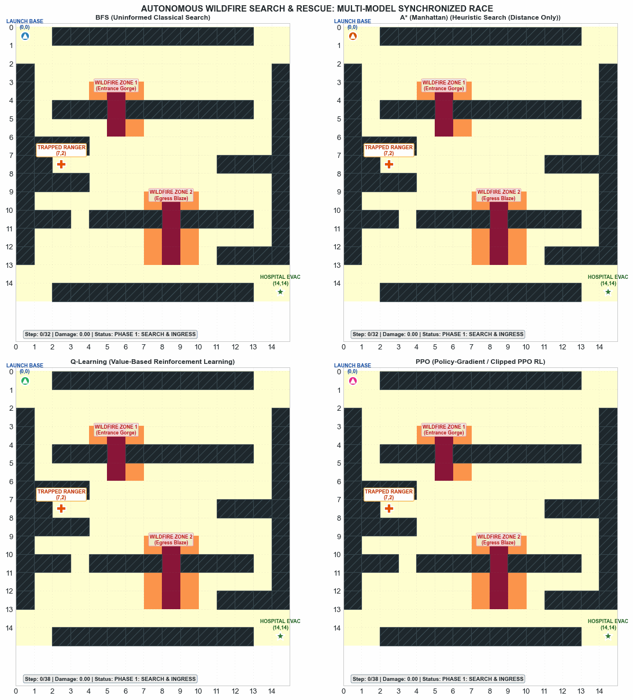
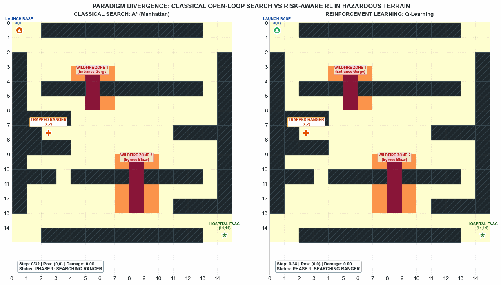

# Autonomous Wildfire Drone Search, Rescue & Evacuation
### From Classical Search (BFS, A*) to Modern Reinforcement Learning (Q-Learning, PPO, SAC)

[](https://www.python.org/downloads/)
[](https://gymnasium.farama.org/)
[](https://opensource.org/licenses/MIT)

An end-to-end Machine Learning and Autonomous Robotics project benchmarked on complex disaster search, rescue, and evacuation scenarios.

This repository is organized into two primary modules:
1. **`Algorithms/`**: Comprehensive benchmarking suite implementing, training, and evaluating classical search against value-based, policy-gradient, and maximum-entropy RL algorithms.
2. **`Game/`**: Full-featured interactive browser game and Human-in-the-Loop RL Studio (`interactive_game.py`) featuring live keyboard flight, procedural maze generation, dynamic fire spreading, and real-time policy teaching (RLHF / DAgger).

---

## 🚁 Live Multi-Model Mission Previews

### 1. Master Synchronized Race (Classical Search vs. Reinforcement Learning)
<p align="center">
  
</p>

### 2. Paradigm Divergence: Open-Loop A* Manhattan vs. Closed-Loop Q-Learning
<p align="center">
  
</p>

---

## 🗺️ Problem Statement & Operational Scenario

In emergency disaster response robotics, an autonomous Unmanned Aerial Vehicle (UAV) is deployed on a critical **Two-Phase Search, Rescue & Evacuation Mission** in a $15 \times 15$ canyon grid ($450$ discrete states):
* **Phase 1 (Search & Ingress):** Launch from **Base (0, 0)**, penetrate mountain barriers, and extract an injured forest ranger trapped in an enclosed interior rock pocket at **(7, 2)** (walled on 3 sides, solitary entrance at `(7, 3)`).
* **Phase 2 (Evacuation & Egress):** Secure the ranger onboard and navigate through secondary escape corridors to deliver the patient to the **Hospital Evacuation Base at (14, 14)**.

### The Core Dilemma (Speed vs. Survival):
The naive shortest geometric distance passes straight through two active wildfire infernos:
* **Fire Zone 1 (Entrance Gorge):** Rows 3–5, Col 5 (Flame Core $T=1.0$, Smoke Fringe $T=0.5$).
* **Fire Zone 2 (Evacuation Blaze):** Rows 9–12, Col 8 (Flame Core $T=1.0$, Smoke Fringe $T=0.5$).

Distance-only search methods (BFS, standard A*) optimize purely for hop count and fly straight through the flames, incurring lethal thermal burns. In contrast, risk-aware algorithms (**A\* Risk-Aware**, **Q-Learning**, **PPO**, **SAC**) learn to navigate western canyon and eastern alpine bypass corridors to accomplish a **flawless zero-hazard extraction**.

---

## 📊 Empirical Benchmark Results

| Algorithm Paradigm | Family | Nodes / Episodes | Compute Time | Path Hops | Thermal Damage | Mission Success |
|---|---|:---:|:---:|:---:|:---:|:---:|
| **BFS** | Uninformed Search | 200 nodes | 0.002 s | 32 hops | **4.50 (Burns)** | 100% |
| **A\* (Manhattan)** | Distance Heuristic Search | 73 nodes | 0.001 s | 32 hops | **4.50 (Burns)** | 100% |
| **A\* (Risk-Aware)** | Safety Heuristic Search | 86 nodes | 0.002 s | 34 hops | **0.00 (Zero)** | 100% |
| **Random Baseline** | Uniform Exploration | 50 episodes | 0.025 s | 220 steps | 0.00 (Lost) | 0.0% |
| **Greedy Distance** | 1-Step Greedy Heuristic | 1 step eval | 0.001 s | 220 steps | 0.00 (Trapped) | 0.0% |
| **Q-Learning** | **Value-Based RL** | 2000 episodes | **2.54 s** | **38 hops** | **0.00 (Zero)** | **100%** |
| **PPO** | **Policy-Gradient RL** | 2000 episodes | **5.80 s** | **38 hops** | **0.00 (Zero)** | **100%** |
| **SAC** | **Maximum Entropy RL** | 2000 episodes | **5.55 s** | **40 hops** | **0.00 (Zero)** | **100%** |

---

## 📁 Repository Structure

```
├── Algorithms/                         # Classical Search & RL Benchmarking Suite
│   ├── wildfire_drone_env.py           # Custom 15x15 Gymnasium Environment (450 States)
│   ├── run_experiments.py              # Benchmarks BFS, A*, Q-Learning, PPO, SAC & Generates Plots
│   ├── generate_demo_gif.py            # Telemetry GIF Animator (Individual & Comparison Races)
│   ├── Wildfire_Drone_Simulation.ipynb # Complete Executable Jupyter Notebook
│   └── figures/                        # High-Resolution Publication PNGs & Telemetry GIFs
│
├── Game/                               # Interactive Playable Game & RL Studio
│   ├── interactive_game.py             # Web Browser Game Engine & Local Server (127.0.0.1:8000)
│   ├── dynamic_wildfire_env.py         # Procedural Maze & Fire Generator with Spreading Dynamics
│   ├── interactive_learning.py         # Dual Q-Table (Q_rel + Q_local), RLHF & DAgger Imitation
│   ├── wildfire_model_manager.py       # Live Model Manager & Blind AI Benchmarking
│   ├── wildfire_drone_env.py           # Underlying Grid Environment
│   └── run_experiments.py              # Algorithm Runners & Model Evaluators
│
├── .gitignore                          # Clean Git Ignore Configuration
└── README.md                           # Project Documentation & Live Demos
```

---

## 🚀 Quick Start Guide

### 1. Installation
Clone the repository and install required packages:
```bash
git clone https://github.com/joewalker0360/Wildfire-Drone-RL-Search.git
cd Wildfire-Drone-RL-Search
pip install numpy gymnasium matplotlib seaborn pillow nbformat
```

### 2. Run the Benchmark Suite & Regenerate Plots
```bash
cd Algorithms
python run_experiments.py
```

### 3. Generate All Individual & Comparative Telemetry GIFs
```bash
python generate_demo_gif.py
```

### 4. Play the Interactive Game & Human-in-the-Loop RL Studio
```bash
cd ../Game
python interactive_game.py
```
* Open your browser to `http://127.0.0.1:8000`.
* Use **Arrow Keys** to pilot the drone manually.
* Race against the **Blind AI Benchmark**!
* Press **Space** to deploy water drops and extinguish active flames.

---

## 👥 Authors & Team Contributions
* **Hector (24024):** Core Algorithms & RL Framework — 15x15 Gymnasium Environment, Classical Search (BFS, A*), Reinforcement Learning (Q-Learning, PPO, SAC), Reward Shaping, and Benchmark Figures.
* **Harimurali (24003):** Interactive Browser Game & RL Studio — Interactive Web Engine (`interactive_game.py`), Procedural Terrain & Dynamic Fire Mechanics (`dynamic_wildfire_env.py`), Dual-System RLHF & DAgger Imitation Learning (`interactive_learning.py`).
